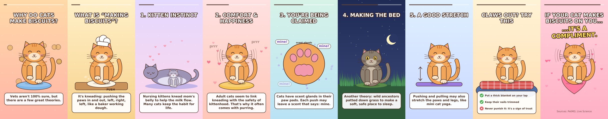
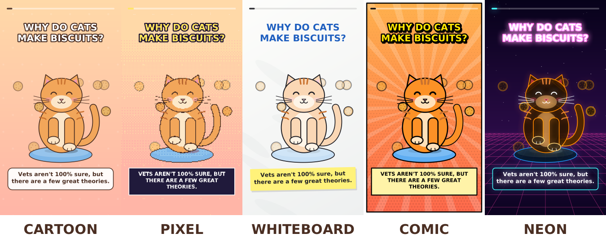

# Why Do Cats Make Biscuits?

A 57-second vertical explainer video (for Shorts, Reels or TikTok) about why cats knead. A cartoon cat walks through five theories, then gives tips for when the claws come out.



## The finished video

| File | What it is |
|---|---|
| [`video/why-cats-make-biscuits.mp4`](video/why-cats-make-biscuits.mp4) | 1080×1920, 30 fps, H.264 + AAC, 57.5 s, with captions and a music bed baked in |
| [`video/why-cats-make-biscuits.srt`](video/why-cats-make-biscuits.srt) | A subtitle file, for platforms that accept separate captions |
| [`SCRIPT.md`](SCRIPT.md) | Scene-by-scene script, optional voiceover lines, posting caption and hashtags, sources |

## Art styles

The same video also comes in four other art styles, with the same script and timing:



| Style | Look | Music | File |
|---|---|---|---|
| Cartoon | Flat pastel cartoon (the original) | Soft music box | [`video/why-cats-make-biscuits.mp4`](video/why-cats-make-biscuits.mp4) |
| Pixel / 8-bit | Chunky pixels, limited palette, retro text boxes | Chiptune | [`video/styles/why-cats-make-biscuits-pixel.mp4`](video/styles/why-cats-make-biscuits-pixel.mp4) |
| Whiteboard | Marker lines on white, each scene "drawn in" by a marker, sticky-note captions | Soft music box | [`video/styles/why-cats-make-biscuits-whiteboard.mp4`](video/styles/why-cats-make-biscuits-whiteboard.mp4) |
| Comic book | Halftone dots, action-line bursts, panel border, narration boxes | Soft music box | [`video/styles/why-cats-make-biscuits-comic.mp4`](video/styles/why-cats-make-biscuits-comic.mp4) |
| Neon / synthwave | Glowing outlines on a dark grid | Synth | [`video/styles/why-cats-make-biscuits-neon.mp4`](video/styles/why-cats-make-biscuits-neon.mp4) |

Everything is generated in code. The cat, the backgrounds and the music are all original, so there's nothing to license and no copyright-claim risk.

## Re-render or edit it

```bash
pip install pycairo numpy      # FFmpeg must also be installed
python3 make_video.py --preview   # out/preview-cartoon.png, one frame per scene (about 1 s)
python3 make_video.py --still 12  # out/still.png, the frame at 12 s
python3 make_video.py             # out/why-cats-make-biscuits.mp4 (about 1 min on 4 cores)
python3 make_video.py --style pixel   # also: whiteboard, comic, neon, or all
python3 make_video.py --compare   # out/styles-compare.png, the same frame in every style
```

To change the wording or timing, edit the `SCENES` list in [`make_video.py`](make_video.py). Each entry has a duration, a headline and a caption, and the subtitles and music cues follow automatically.
