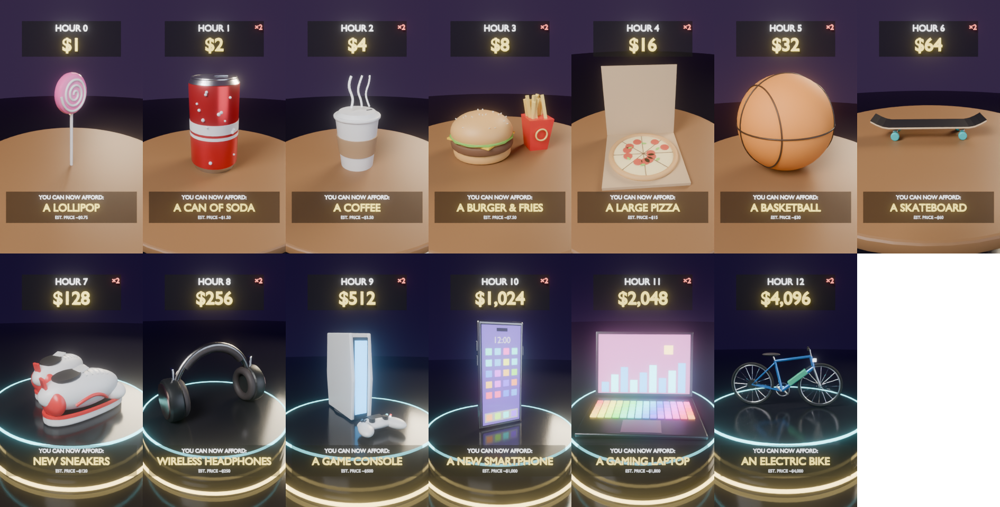
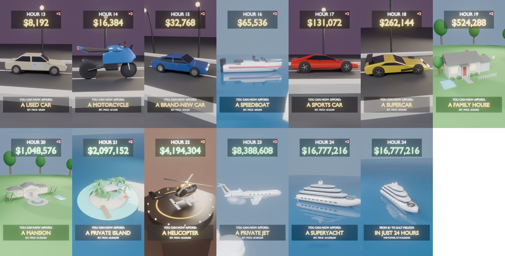

# $1 That Doubles Every Hour: What Can You Buy?

A ~46 second vertical (1080×1920, 30 fps) 3D animation. You start with **$1**. Every hour the money doubles (**balance = 2^H dollars**), and at each hour a physical 3D model of something that balance can buy lands in the frame.

Purchases only illustrate purchasing power. Nothing is ever spent: the balance keeps doubling from the original $1, so hour 24 shows **$16,777,216**.

Everything below is generated by [`animation.py`](animation.py) from one data table (`PURCHASES`). Edit a row there and the timeline, camera, HUD, effects and models all rebuild.




*Preview stills: Cycles at 12 samples, 25% resolution, motion blur off.*

---

## 1. Purchase progression and pacing

| Hr | Balance | You can now afford | Est. price | Frames | Sec | Entrance | Camera | Stage |
|---:|---:|---|---:|---|---:|---|---|---|
| 0 | $1 | A Lollipop | $0.75 | 1–21 | 0.70 | pop | punch_in | table |
| 1 | $2 | A Can of Soda | $1.50 | 22–43 | 0.73 | drop | orbit | table |
| 2 | $4 | A Coffee | $3.50 | 44–66 | 0.77 | drop | orbit_r | table |
| 3 | $8 | A Burger & Fries | $7.50 | 67–90 | 0.80 | drop | orbit | table |
| 4 | $16 | A Large Pizza | $15 | 91–115 | 0.83 | flip | push_low | table |
| 5 | $32 | A Basketball | $30 | 116–141 | 0.87 | drop | orbit_r | table |
| 6 | $64 | A Skateboard | $60 | 142–168 | 0.90 | drive_in | orbit | table |
| 7 | $128 | New Sneakers | $120 | 169–196 | 0.93 | drop | punch_in | pedestal |
| 8 | $256 | Wireless Headphones | $250 | 197–225 | 0.97 | pop | orbit_r | pedestal |
| 9 | $512 | A Game Console | $500 | 226–255 | 1.00 | rise | rise_reveal | pedestal |
| 10 | $1,024 | A New Smartphone | $1,000 | 256–303 | 1.60 | rise | rise_reveal | pedestal |
| 11 | $2,048 | A Gaming Laptop | $1,800 | 304–353 | 1.67 | spin_in | orbit | pedestal |
| 12 | $4,096 | An Electric Bike | $4,000 | 354–405 | 1.73 | drive_in | tracking | pedestal |
| 13 | $8,192 | A Used Car | $8,000 | 406–460 | 1.83 | drive_in | tracking | road |
| 14 | $16,384 | A Motorcycle | $13,000 | 461–517 | 1.90 | speed_pass | low_speed | road |
| 15 | $32,768 | A Brand-New Car | $25,000 | 518–576 | 1.97 | spin_in | showroom | road |
| 16 | $65,536 | A Speedboat | $60,000 | 577–637 | 2.03 | speed_pass | low_speed | ocean |
| 17 | $131,072 | A Sports Car | $120,000 | 638–701 | 2.13 | speed_pass | low_speed | road |
| 18 | $262,144 | A Supercar | $250,000 | 702–767 | 2.20 | slam | orbit_r | road |
| 19 | $524,288 | A Family House | $420,000 | 768–845 | 2.60 | build | crane_up | lawn |
| 20 | $1,048,576 | A Mansion | $1,000,000 | 846–929 | 2.80 | build | crane_up | lawn |
| 21 | $2,097,152 | A Private Island | $2,000,000 | 930–1019 | 3.00 | emerge | aerial_orbit | ocean |
| 22 | $4,194,304 | A Helicopter | $3,500,000 | 1020–1115 | 3.20 | descend | heli_tilt | helipad |
| 23 | $8,388,608 | A Private Jet | $7,000,000 | 1116–1219 | 3.47 | fly_by | fly_by | sky |
| 24 | $16,777,216 | A Superyacht | $15,000,000 | 1220–1343 | 4.13 | emerge | epic_pullback | ocean |
| — | outro | "From $1 to $16.7 million" | | 1344–1388 | 1.50 | | pull-back | ocean |

**Total: 1,388 frames = 46.3 s.** Regenerate this table with `python3 animation.py --table`. The script asserts that every price is ≤ that hour's balance.

Pacing comes in three tiers:

- **Rapid (hours 0–9):** 0.7–1.0 s each. These are quick pop/drop gags, so cheap items blur past.
- **Medium (hours 10–18):** 1.6–2.2 s each. Real reveals: rising phone, drive-ins, speed passes.
- **Dramatic (hours 19–24):** 2.6–4.1 s each. Self-building houses, an island and a yacht rising from the ocean, a jet flying past the camera, and gold coins raining on every reveal.

Each tier also scales the effects: sparkle bursts grow from 16 to 26 to 40 particles, and items fill more of the frame each hour.

## 2. Shot-by-shot storyboard

| Hr | What happens on screen | Transition out |
|---:|---|---|
| 0 | Dark studio, wooden table. A pink swirl lollipop **pops** up spinning; the camera punches in. "$1" is all you have. | Shrinks and spins away into a gold sparkle burst |
| 1 | A red soda can with condensation **drops** onto the table and bounces. | Sparkle burst; the can morphs out |
| 2 | A takeaway coffee with a kraft sleeve drops in, steam curling. | " |
| 3 | **Burger and fries fall onto the table**: sesame bun, cheese, lettuce, tomato, and a fries carton. | " |
| 4 | An open pizza box **flips** in from above; the camera looks down at the pepperoni. | " |
| 5 | A basketball drops and bounces with a heavy, satisfying settle. | " |
| 6 | A skateboard **rolls in** from the left with its wheels spinning. | Table sinks away and the stage changes |
| 7 | Glowing pedestal. **Sneakers drop from above and rotate.** | " |
| 8 | Over-ear headphones pop onto the pedestal. | " |
| 9 | A game console **rises** out of the pedestal with a controller in front, blue light strip glowing. | Tempo shifts to medium |
| 10 | **A smartphone rises from the pedestal**, spinning 360° and showing the camera bump, then settles screen-forward (app grid, 12:00). | " |
| 11 | A gaming laptop spins in: RGB keyboard, neon skyline on screen. | " |
| 12 | An e-bike rolls across the pedestal; the camera tracks it. | Pedestal gives way to a night road |
| 13 | **A used car drives into the scene**: a beige sedan with a grey primer replacement door. Wheels roll; the camera pans with it. | Whip-pan to the next angle |
| 14 | A motorcycle blasts in low and fast (speed pass, motion blur). | " |
| 15 | A brand-new blue sedan spins in showroom-style. | Cut to the ocean |
| 16 | A speedboat **speeds across the water** with twin outboards. | Back to the road |
| 17 | **A red sports car accelerates across the screen** with a low tracking camera. | " |
| 18 | A yellow supercar with a rear wing **slams down** from the sky, squashes and settles. | Night turns to day |
| 19 | Daylight lawn. A family house **builds itself bottom-up**: walls, roof, chimney, garage, pool, fence. Coins rain. | Crane up |
| 20 | **A mansion builds itself from the ground up**: wings, columns, pediment, fountain, palms, pool. | " |
| 21 | Ocean. A private island **emerges** from a turquoise lagoon: palms, villa, dock. | " |
| 22 | Sunset helipad. A gold-trim helicopter **descends** with its rotors spinning. | " |
| 23 | Open sky. **A private jet sweeps past the camera** and settles into a banked cruise while clouds stream by. | " |
| 24 | **A superyacht surges up out of the ocean**: three decks, helipad, jacuzzi, gold boot-stripe. Coin shower; the camera pulls back. | Outro: gold firework bursts, "FROM $1 TO $16.7 MILLION / IN JUST 24 HOURS / THE POWER OF DOUBLING" |

## 3. On-screen information (HUD)

The HUD is parented to the camera, so it never drifts, and it sits inside TikTok's safe area:

```
┌─────────────────────────┐
│        HOUR 17     ×2   │  ← TOP: hour label; "×2" badge pops each hour
│      $131,072           │  ← CENTER: balance (gold; money-green from hour 20)
│                         │
│      [ 3D PRODUCT ]     │  ← camera auto-frames the model between the text bands
│                         │
│  YOU CAN NOW AFFORD:    │  ← BOTTOM
│     A SPORTS CAR        │
│   EST. PRICE ~$120,000  │
└─────────────────────────┘
```

- Text is emissive (unlit), with a drop shadow and a translucent dark plate, so it stays readable over any stage.
- Long strings auto-shrink to fit the width.
- Each hour's HUD pops in (scale 0.6 → 1 with overshoot) at the exact frame the balance doubles.
- The camera distance is solved per hour from the model's bounding box, so the product fills the centre without covering the text.

## 4. Transitions: one continuous piece, not 25 clips

Every hour boundary uses the same connective tissue:

1. **The previous item morphs out.** Over its last ~0.4 s it anticipates (a back-ease), then shrinks to nothing while spinning 160° and lifting.
2. **A burst at the swap frame.** Gold sparkles fly outward and a gold flash ring expands and vanishes, centred where the old item disappeared.
3. **The new item enters from that point.** It pops, drops, rises, drives in and so on, so the old item seems to become the new one.
4. **A camera whip.** The camera eases from the previous framing to the new one over the first 4–10 frames, and render motion blur turns that into a whip-pan.
5. **The environment escalates.** The background colour and sun cross-fade with each stage change (studio → road at dusk → daylight → ocean → sky), and the stage itself pops in.

## 5. Technical implementation

`animation.py` is fully data-driven:

| Requirement | Where |
|---|---|
| Hour number, exact balance (`2**hour`), item, estimated price | `PURCHASES` row → `HourScene.balance` |
| 3D model generation function | `HourScene.model_fn` → `build_*()` builders (25 of them) |
| Animation start/end frames | `build_timeline()` fills `HourScene.start/end` from the per-row frame counts |
| Camera movement | `HourScene.camera_move` → `CAMERA_MOVES` keyframe recipes |
| On-screen text | `HourScene.text` → `{"top", "center", "bottom"}` → `build_hud()` |
| Entrance style | `HourScene.entrance` → `animate_product()` |
| Environment | `HourScene.stage` → `STAGE_BUILDERS` + `STAGE_LOOK` |

How the pipeline works:

- **Build.** For every row, the pipeline builds the model procedurally, normalises it to `display_size(hour)`, keyframes it, keyframes its visibility, adds the HUD and the effects, and keys the camera rig.
- **Keyframes, not a frame handler.** All motion is real keyframes and F-curves (bezier, back, bounce, expo, linear). That includes rolling wheels, spinning rotors, the build-up sequences, coins, clouds and the ocean modifier's time, so the .blend renders anywhere.
- **Hand-written geometry.** The models use a small toolkit of beveled primitives, profile extrusions (car silhouettes, wings, roofs), lofted V-hulls (boats), NURBS tubes (bike frames, rails, palm trunks) and font objects. No modelling by hand, no external assets.
- **Version fallbacks.** Tested on Blender 5.2. The script includes fallbacks for Blender 4.2+ APIs: EEVEE engine ID, Principled socket names, layered vs legacy actions, compositor tree, Glare type, and FFmpeg output.

```bash
python3 animation.py --validate                                  # data checks, no Blender needed
blender -b --python-exit-code 1 -P animation.py -- --validate-scene --save "$PWD/scene.blend"
blender -b scene.blend --python-exit-code 1 -P animation.py -- --use-open-scene --mode final --render-frames 1-1388
```

Rendering is Cycles on the CPU by default, so no GPU is needed. The GitHub Actions workflow renders in parallel chunks and encodes with FFmpeg; see README.md.

Building the scene takes about 3–4 minutes on CPU. It creates roughly 2,000 objects, because every part is its own object so it can be animated separately.

## 6. Honest limitations and the asset-based alternative

The models are **stylised procedural low-poly**, not photorealistic. They read clearly at phone size and in motion, but:

- **Cars, jet, helicopter and yacht** are built from side-profile extrusions and lofts. The silhouettes are right, but there are no compound curves, panel gaps or interiors.
- **Sneakers** are the weakest model. A shoe's organic shape is hard to get from primitives, and it reads as a chunky cartoon sneaker.
- **Mansion and island** are believable as toy dioramas, not architectural renders.
- **Ocean** uses Blender's Ocean modifier. There is no foam or splash simulation; the "splash" on emergence is the sparkle burst.

**Asset alternative (built in).** Put a licensed model in `assets/<name>.glb` (or `.gltf`, `.fbx`, `.obj`). Here `<name>` is the builder name without `build_`, for example `assets/private_jet.glb` or `assets/superyacht.glb`. The pipeline then imports it instead of the procedural builder, and auto-scales, grounds, animates, frames and transitions it the same way.

- Vehicles should face +X; everything else should face -Y.
- Imported assets don't get wheel or rotor spin unless you add the procedural roles.
- Good CC0 or royalty-free sources: Poly Haven, Kenney, Quaternius, and Sketchfab's CC-BY/CC0 filters. Check each licence and credit as required.

## 7. Price notes

Prices are rounded **illustrative estimates for the U.S.**, not quotes. The higher-value items were checked against public listings in Oct 2026:

- **Game console, $500.** Sony's April 2026 increase put the PS5 Digital at $599.99 and the PS5 Pro at $899.99 ([PlayStation Blog](https://blog.playstation.com/2026/03/27/new-price-changes-for-ps5-ps5-pro-and-playstation-portal-remote-player/)). $512 therefore buys a hybrid/handheld-class console, so the model is a generic console, not a specific product.
- **New car, $25,000.** 2026 compact sedans start around $22.6k–$24.7k: Sentra, Corolla, Jetta, Mazda3 ([Autofinder: Corolla](https://autofinder.com/cars/toyota/corolla/2026), [Mazda3](https://autofinder.com/cars/mazda/mazda3-sedan/2026), [Yahoo Autos](https://autos.yahoo.com/deals-and-buying-guides/articles/2026s-6-cheapest-cars-according-191500551.html)).
- **Private jet, $7,000,000.** New light jets list for about $4.5M–$7M depending on spec ([Flycraft](https://flycraft.com/articles/cost-to-buy-a-private-jet), [GlobalAir](https://www.globalair.com/articles/private-jet-comparison-phenom-100ev-vs-citation-m2-gen2/7552)).
- **Superyacht, $15,000,000.** Used ~40 m superyachts list for about $8M–$19M ([YachtBuyer: Sunseeker 40 Metre](https://www.yachtbuyer.com/en-us/sunseeker/for-sale/40-metre-yacht), [Princess 40M](https://www.yachtbuyer.com/en/princess/for-sale/princess-40m)).
- **Unverified estimates.** Everything else (snacks, sneakers, phone, e-bike, used car, house near the U.S. median, a $1M luxury home, a small private island, a light turbine helicopter) uses typical-range estimates. On screen it is labelled **"EST. PRICE ~"**.
