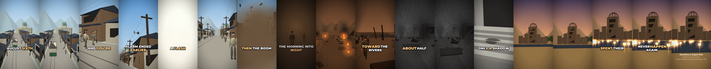

# Hiroshima, 1945: A Pedestrian's View

A 55-second vertical short (1080×1920, 30 fps) about the morning of 6 August 1945, told in the second person from the street. It is built from widely documented survivor (hibakusha) testimony.



| File | What it is |
|---|---|
| [`video/hiroshima-1945.mp4`](video/hiroshima-1945.mp4) | The finished video, with narration, sound and captions |
| [`video/hiroshima-1945.srt`](video/hiroshima-1945.srt) | Subtitles, line by line |

## Script

> August sixth, 1945. Hiroshima. It's a quarter past eight in the morning, and you're walking to work. The air raid alarm ended earlier. The sky is clear. Then, a flash. Brighter than the sun. Survivors called it pika-don. The flash, then the boom. Dust turns the morning into night. When it clears, the city is gone. Fires spread. People walk in silence toward the rivers, asking for water. About half an hour later, a black rain falls. On the steps of a bank, one person left only a shadow. By the end of that year, around a hundred and forty thousand people had died. The survivors, the hibakusha, spent their lives sharing what they saw, so it would never happen again.

## Approach

- **Respectful by design.** People are simple faceless figures, mostly seen from behind or at a distance. Injuries are not shown. The palette is muted and the music is sparse.
- **The explosion.** A single white-out (not a strobe) fades to reveal a fireball over the city, turning the sky orange and everything facing you into silhouette. A wall of dust then races down the street, flattening houses, while the ground trembles. At impact the camera is thrown back and tilted into a warm burst of heat, debris and dust. Viewers sensitive to bright flashes should be aware of the flash at about 0:13.
- **Sound.** Morning cicadas, birds and a streetcar bell cut to a ringing silence at the flash. A low rumble swells as the shockwave approaches, then comes a sub-bass hit, a crack and a long rumble with debris landing, then deafened ringing, wind and fire. The narration pauses so the impact lands on its own. The ending has water and a quiet piano.
- **Ending.** Present-day peace lanterns float on the river below the Atomic Bomb Dome.

## Accuracy notes

- The all-clear was given at 7:31 a.m. The bomb exploded at 8:15 a.m. ([ICRC](https://www.icrc.org/eng/assets/files/other/irrc-231-junod.pdf), [OSTI](https://www.osti.gov/opennet/manhattan-project-history/Events/1945/hiroshima.htm)).
- Rain fell about half an hour after the explosion. The "black rain" carried radioactive fallout, mostly northwest of the hypocentre ([ICRC](https://www.icrc.org/eng/assets/files/other/irrc-231-junod.pdf), [Hiroshima Peace Media Center](https://www.hiroshimapeacemedia.jp/hiroshima-koku/en/exploration/index_20080428.html)).
- About 140,000 deaths by the end of 1945 is the commonly cited estimate. Others range from about 100,000 upward, and later totals are higher ([Origins, Ohio State](https://origins.osu.edu/milestones/august-2015-hiroshima)).
- "Pika-don" (flash-boom) is the survivors' own name for the bomb. The shadow refers to the stone steps of the Sumitomo Bank, now in the Hiroshima Peace Memorial Museum.
- The streets, houses and buildings are simplified impressions, not reconstructions. The Atomic Bomb Dome (the former Industrial Promotion Hall) is drawn loosely.

## Re-render

It reuses the renderer, Kokoro voice, Whisper word timing and caption code from [`../while-youre-at-work/make_short.py`](../while-youre-at-work/make_short.py).

```bash
pip install pycairo numpy kokoro-onnx faster-whisper    # plus FFmpeg
python3 make_short.py --sheet     # out/sheet.png, one frame per shot
python3 make_short.py             # out/hiroshima-1945.mp4 (about 2-3 minutes on 4 cores)
```

The narration and timing are cached in `out/`, so later renders skip the voice step. The repo copy of the video was re-encoded at CRF 24 to keep the file under 30 MB.
