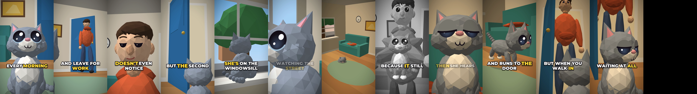

# While You're at Work

A 24-second vertical short (1080×1920, 30 fps) told from a cat's point of view: what she does all day while you're out, and how she pretends she wasn't waiting when you get home.



- **Low-poly 3D look:** faceted, flat-shaded characters with big glossy eyes, drawn by a small 3D renderer in [`make_short.py`](make_short.py) (numpy + cairo, no Blender needed).
- **Natural narration:** read by `af_heart`, a warm US English voice from the open [Kokoro](https://huggingface.co/hexgrad/Kokoro-82M) text-to-speech model, over an original piano bed with door and key sound effects. The mix is normalised to about -15 LUFS, a typical level for social video.
- **Word-timed captions:** short 2-4 word phrases in Montserrat Black with a thick outline. The word being spoken turns yellow and pops. [Whisper](https://github.com/SYSTRAN/faster-whisper) listens to the narration to time every word, and scene cuts land on the words too.
- **Grey flashback** of her as a kitten, for the "it still smells like you" line.

| File | What it is |
|---|---|
| [`video/while-youre-at-work.mp4`](video/while-youre-at-work.mp4) | The finished video, with voice, music and captions |
| [`video/while-youre-at-work.srt`](video/while-youre-at-work.srt) | Subtitles, line by line |

## Script

> Every morning, you grab your keys and leave for work. You probably think your cat doesn't even notice. But the second that door closes, she's on the windowsill, watching the street. Hours go by. She curls up on your hoodie, because it still smells like you. Then she hears your keys... and runs to the door. But when you walk in, she acts like she wasn't waiting at all.

## Re-render or change it

```bash
pip install pycairo numpy kokoro-onnx faster-whisper   # plus FFmpeg
python3 make_short.py --sheet          # out/sheet.png, one frame per shot (a few seconds)
python3 make_short.py                  # out/while-youre-at-work.mp4 (about 1 minute on 4 cores)
```

The first run downloads the Kokoro model (about 330 MB) and Whisper `base.en` (about 150 MB) into `voices/`. To try another voice, change `VOICE_NAME` in `make_short.py` (for example `af_bella`, `am_michael`, `bf_emma` or `bm_george`). The caption font is in `fonts/`, under the SIL Open Font License (`fonts/OFL.txt`). To tell a different story, edit `SEGMENTS` at the top of `make_short.py`: each line of narration lists the shots it plays over and how many words each shot covers, so the cuts follow the voice. New shots are `shot_<name>(ctx, t, duration)` functions that place the cat, the owner and the camera in the room.
